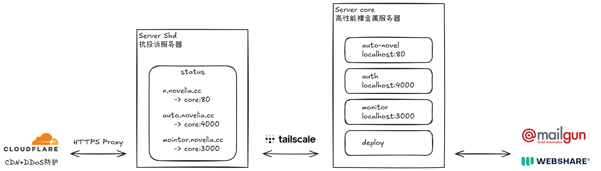

# Deploy 服务器部署手册

[](https://github.com/auto-novel/deploy#license)

本手册介绍 AutoNovel 服务器的部署流程，网站架构如下：



## 安装操作系统

### 安装 Debian

```bash
curl -O https://raw.githubusercontent.com/bin456789/reinstall/main/reinstall.sh || wget -O reinstall.sh $_
bash reinstall.sh debian 12 --username root --password 'password'
reboot
```

重装完成后，在本地使用 `ssh-copy-id` 上传公钥，然后登录服务器后安装基础工具：

```bash
apt-get update
apt-get upgrade -y
apt-get install -y vim ca-certificates curl gnupg git
```

### 禁用 SSH 密码登录

```bash
SSH_PORT=$(shuf -i 10000-65535 -n 1)
printf 'SSH 端口：%s\n' "$SSH_PORT"

sed -i -E \
  -e "s/^#?Port .*/Port $SSH_PORT/" \
  -e 's/^#?PasswordAuthentication .*/PasswordAuthentication no/' \
  -e 's/^#?KbdInteractiveAuthentication .*/KbdInteractiveAuthentication no/' \
  /etc/ssh/sshd_config
sshd -t && systemctl reload ssh
```

使用以下命令测试，预期密码登录失败：

```bash
ssh -p 12345 -o PubkeyAuthentication=no -o PreferredAuthentications=password root@服务器IP
```

## 配置 Shield 服务器

### 初始化

```bash
cd /root
git clone https://github.com/auto-novel/deploy.git
cd /root/deploy/host-shield
HOST_NAME=shd1 ./bootstrap.sh
```

脚本会安装 Docker、Cloudflared 和 Tailscale，配置防火墙并同步登录环境。如提示登录 Tailscale，请打开终端提供的链接完成登录。初始化完成后，请新建 SSH 连接，确认可正常登录。

### 部署 Shield 服务

参照 [Shield 部署说明](https://github.com/auto-novel/shield#部署)，克隆服务仓库：

```bash
cd /root
git clone https://github.com/auto-novel/shield.git
cd /root/shield
```

打开 Cloudflare 的 [API Token 配置页面](https://dash.cloudflare.com/profile/api-tokens)，选择所用 Token 的 `Edit`，将 Shield 服务器的公网 IP 添加到 `Client IP address filtering` 白名单。

```bash
printf 'CLOUDFLARE_API_TOKEN=%s\n' '你的Cloudflare_API_Token' > .env
./scripts/gen-proxy.sh
docker compose up -d
```

## 配置 Core 服务器

### 初始化

```bash
cd /root
git clone https://github.com/auto-novel/deploy.git
cd /root/deploy/host-core
./bootstrap.sh
```

脚本会安装 Docker、Cloudflared 和 Tailscale，配置防火墙并同步登录环境。如提示登录 Tailscale，请打开终端提供的链接完成登录。初始化完成后，请新建 SSH 连接，确认可正常登录。

### 部署服务

分别部署以下服务：

- [Monitor](https://github.com/auto-novel/monitor)
- [Auth](https://github.com/auto-novel/auth)
- [Forum](https://github.com/auto-novel/forum)
- [AutoNovel](https://github.com/auto-novel/auto-novel)
- [AutoComic](https://github.com/auto-novel/auto-comic)

## 运维

### 更新服务

在本地通过 SSH 更新单个服务：

```bash
# 更新 auth
ssh core 'cd /root/auth && git pull --ff-only && docker compose pull && docker compose up -d'

# 更新 forum
ssh core 'cd /root/forum && git pull --ff-only && docker compose pull && docker compose up -d'

# 更新 auto-novel
ssh core 'cd /root/auto-novel && git pull --ff-only && docker compose pull && docker compose up -d'

# 更新 auto-comic
ssh core 'cd /root/auto-comic && git pull --ff-only && docker compose pull && docker compose up -d'
```

在本地通过 SSH 重新应用 Core 配置：

```bash
ssh core 'cd /root/deploy && git pull --ff-only && cd host-core && ./apply.sh'
```

### 更新防火墙

普通 `apply.sh` 不修改防火墙，更新规则需显式添加 `--firewall`：

```bash
# 按主机选择 host-core 或 host-shield
(cd host-core && ./apply.sh --firewall)
```

更新前会运行 `nft -c` 校验，随后以一个事务替换本项目管理的表，写入 `/etc/nftables.conf` 并启用开机加载。不会重启 nftables 服务，也不会清空 Docker/Tailscale 的规则。目前没有自动回滚，更新后请确认网络连通性，必要时使用服务器控制台恢复。

**旧版 Core 迁移注意：** 新规则使用 `inet core_filter` 表；旧版的 `inet filter` 表不会自动删除。首次迁移应在控制台检查旧表，在确认它仅属于本项目后删除，否则两套规则会同时生效，旧规则可能继续拦截新放行的端口。

### 图片构建

`script/r2.py` 将 `archive/` 中的静态图片压缩为 WebP，输出到 `dist/`，文件名带内容 hash：

```bash
pip install -r script/requirements.txt
python3 script/r2.py
```

输出目录和压缩参数在脚本开头的常量中修改，脚本不接受命令行参数。

### 备份

```bash
rsync -avhzP core:/root/auto-novel/data/files-extra ./
rsync -avhzP core:/root/auto-novel/data/files-wenku ./
rsync -avhzP core:/root/auto-novel/data/db.backup ./
```
